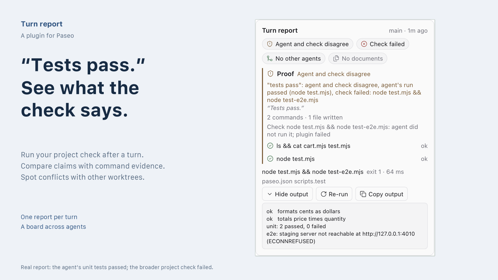

# Turn report for Paseo



See which agent turns need attention in [Paseo](https://github.com/getpaseo/paseo).

- Run the project check you set or approved after each turn.
- Compare claims such as "tests pass" with the commands the agent ran.
- Flag merge conflicts with other live agents' worktrees and review results in one board.

Each report also lists the documents changed during the turn that the PDF and Office viewer plugin's card does not. [OVERVIEW.md](OVERVIEW.md) explains the verdicts, configuration and limits. Command evidence supports review; it does not establish that a change is correct.

## Install

Requires Paseo 0.11.2 or later with plugins enabled. Conflict detection needs Git 2.38 or later on the daemon host. The project check needs a macOS or Linux daemon.

```sh
paseo plugin add https://github.com/nkwib/paseo-turn-report.git
```

Plugins run unsandboxed on the daemon host. Read the code before you install it.

The plugin has no runtime dependencies beyond the libraries Paseo provides, so installation runs no build step.

## Configure the check

Set "Check command" in Settings, Turn report, or add a script to the workspace's `paseo.json`:

```json
{ "scripts": { "test": { "command": "npm test" } } }
```

The plugin uses `scripts.verify`, then `scripts.check`, then `scripts.test`. A command from `paseo.json` runs only after you approve it from the card or the board, because an agent can edit that file. The setting runs without approval.

Approval pins the command text, not what it runs. The check runs project code, including code the agent just wrote, as the daemon's user and outside any agent sandbox.

## Development

Listing images are 1920 × 1080 PNGs composed from the original screenshots. To rebuild them, install Pillow 12 or later and run `python3 scripts/compose-listing.py`. Layout and copy live in [assets/listing/layout.json](assets/listing/layout.json). Screenshots are cropped and scaled down only. Set `LISTING_FONT` and `LISTING_FONT_BOLD` to use other installed TrueType fonts.

```sh
npm ci
npm run typecheck
npm test
```

Tests create temporary Git repositories, so they need `git` 2.38 or later on `PATH`.

CI compiles a clean `git archive` of `HEAD`, with no `node_modules`, against the released Paseo 0.11.2, 0.11.4 and 0.12.0 compilers. It also reads the manifest and evaluates the server contribution with each host's own runtime. Missing host validation fails those jobs.

Run the same check locally with an installed Paseo CLI prefix:

```sh
PASEO_RUNTIME=/path/to/paseo-prefix PASEO_REQUIRE_INSTALL=1 npm test -- test/install.test.ts
```

For development builds, set `PASEO_SOURCE` to a dependency-ready getpaseo/paseo checkout. The test always compiles that checkout; `PASEO_REFS=v0.11.2,v0.11.4,v0.12.0` additionally selects compiler refs that must exist in it. Without either host variable, the ordinary test run skips host validation and states why. Invalid explicit host paths and missing requested refs fail rather than skip. Commit changes before this check: it validates `HEAD`, not uncommitted files.

## License

MIT. See [LICENSE](LICENSE).
